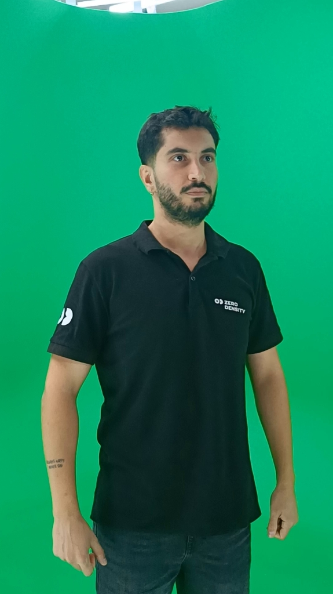
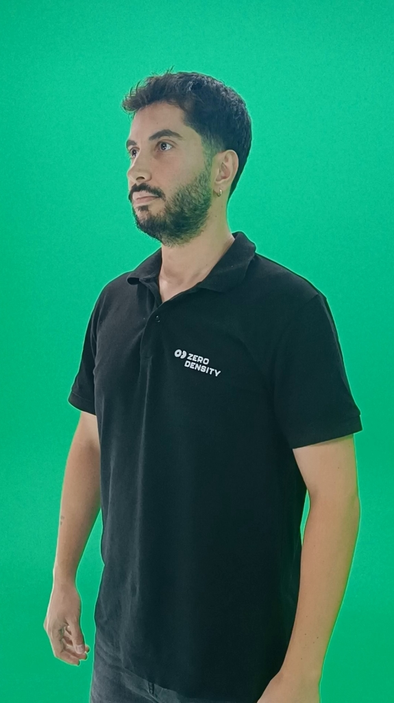
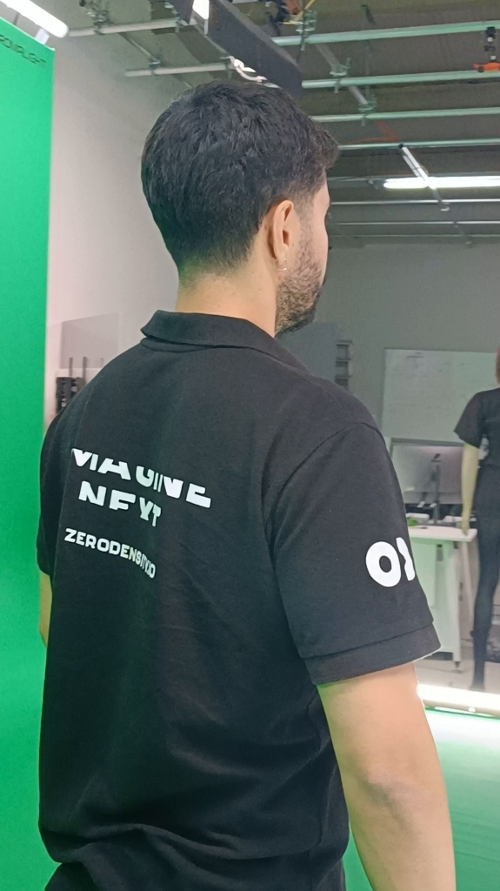

# SplatIm

SplatIm is a Windows desktop application for turning a photo or a moving-camera capture into a 3D Gaussian splat. It combines quick single-image generation, multi-view scene reconstruction, subject selection from video, and an interactive local viewer in one browser interface.

> [!NOTE]
> SplatIm is an active prototype configured for a Windows workstation with an NVIDIA GPU and locally installed model environments. A clean-machine installer is not available yet.

<p align="center">
  
</p>

## What it can do

| Workflow | Input | Result |
| --- | --- | --- |
| **Create splat** | One photo, or one frame from a video | A fast SHARP Gaussian splat estimate |
| **Video → selected subject** | An orbit video around a mostly stationary subject | A subject-focused splat with inspectable processing stages |
| **Multiple photos → one scene** | Overlapping photos or moving-camera video | One connected multi-view Gaussian scene |
| **View splat** | `.ply`, `.splat`, or `.ksplat` | An interactive local 3D view |

## Video-to-subject pipeline

The subject workflow is designed to make every important decision inspectable before expensive training begins.

```text
Orbit capture → COLMAP alignment → target prompt → SAM 2.1 tracking
              → optional MatAnyone2 refinement → Brush training
              → mask-guided extraction → interactive inspection
```

### 1. Capture an orbit

Move the camera smoothly around a person or object that stays as still as possible. Neighboring views must overlap; a fixed camera filming a moving subject does not provide the camera motion required for reconstruction.

The black-shirt sequence below is a representative source capture. It covers the subject from multiple angles while keeping scale and lighting reasonably consistent.

<table>
  <tr>
    <td align="center"></td>
    <td align="center"></td>
    <td align="center"></td>
  </tr>
  <tr>
    <td align="center"><sub>Front coverage</sub></td>
    <td align="center"><sub>Three-quarter coverage</sub></td>
    <td align="center"><sub>Rear coverage</sub></td>
  </tr>
</table>

### 2. Prepare and align the views

Upload the orbit video and choose a quality preset. SplatIm samples up to 120 frames, reconstructs camera positions with COLMAP, and presents the registered views for inspection. Missing angles, blurred frames, abrupt cuts, and weak overlap should be corrected at this stage.

### 3. Select the subject

Choose a registered frame and paint a rough stroke inside the subject. SAM 2.1 propagates that prompt through the aligned sequence. Review the overlay and raw-mask galleries, then correct any frame that loses foreground or includes background.

### 4. Refine the masks when needed

MatAnyone2 can optionally produce a separate alpha refinement. Compare its gallery with the SAM 2.1 result and keep the stronger source. The most recently accepted masks become the training masks.

### 5. Train the Gaussian scene

Brush trains one scene from the aligned views and accepted masks. Preview quality is useful for validating alignment; Standard and High quality trade more time for detail.

### 6. Extract and inspect the subject

Mask-guided extraction separates accepted, uncertain, and rejected Gaussians. The optional recovery controls can score uncertain splats without retraining. Open the final subject splat in the local viewer and check it from several angles.

See [Workflow guide](docs/workflows.md) for detailed UI and command-line usage, and [Optimization notes](docs/optimization.md) for recovery scoring, progress behavior, and measured tradeoffs.

## Quick start on the configured workstation

From PowerShell:

```powershell
& '.\outputs\Start-SharpSplatUI.ps1'
```

The launcher opens the local interface at [http://127.0.0.1:7869](http://127.0.0.1:7869).

The launcher expects the Python environment, model weights, and upstream tools installed under `work/`. Those large local dependencies are not included in the repository, so a clone alone is not yet a portable installation.

## Capture checklist

- Move the camera around a mostly stationary subject; do not rotate only the subject.
- Keep adjacent views overlapping and camera motion slow.
- Avoid motion blur, abrupt cuts, exposure shifts, and changing focal length.
- Include front, side, and rear coverage when the final splat must be viewable from every angle.
- Inspect propagated masks before training. Missing foreground removes subject detail; included background creates stray Gaussians.

## Repository layout

```text
SplatIm/
├── README.md                  Project overview and pipeline walkthrough
├── docs/                      Maintained documentation
│   ├── assets/pipeline/       Curated README source photos only
│   ├── optimization.md        Recovery scoring and performance notes
│   └── workflows.md           Detailed local workflow and verification notes
├── outputs/                   Application source, launchers, and local viewer
│   └── viewer-assets/         Vendored browser viewer modules
├── tests/                     Unit tests and smoke checks
└── work/                      Research scripts and local-only dependencies
```

`outputs/` retains its historical name because launchers and local workflows depend on it. Generated job folders beneath it are ignored by Git. Keeping that path unchanged avoids altering the application architecture or pipeline behavior.

## Repository artifact policy

Only source code, documentation, tests, small configuration files, and intentionally curated media under `docs/assets/` belong in Git.

Do not commit generated splats, masks, processed frames, videos, checkpoints, arrays, caches, logs, or job directories. In particular, keep these local:

- `outputs/video-subject-jobs/`
- `outputs/multi-view-scenes/`
- `outputs/my-splats/`
- `outputs/sample-splat/`
- model weights and virtual environments under `work/`
- `.ply`, `.splat`, `.ksplat`, `.npy`, `.npz`, and video artifacts

The README photos are selected source-capture examples. They are documentation assets, not generated masks, model outputs, or render results.

## Documentation

- [Workflow guide](docs/workflows.md)
- [Optimization notes](docs/optimization.md)
- [Documentation asset policy](docs/assets/README.md)

## Upstream projects

SplatIm builds on [Apple SHARP](https://github.com/apple/ml-sharp) for single-image splat generation, [COLMAP](https://github.com/colmap/colmap) for camera reconstruction, [SAM 2](https://github.com/facebookresearch/sam2) for video mask tracking, [MatAnyone2](https://github.com/pq-yang/MatAnyone2) for optional alpha refinement, and [Brush](https://github.com/VAST-AI-Research/Brush) for Gaussian scene training. Refer to each upstream project for its license and model terms.
