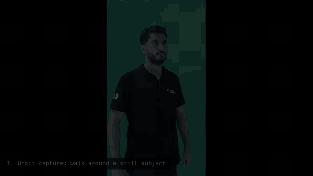
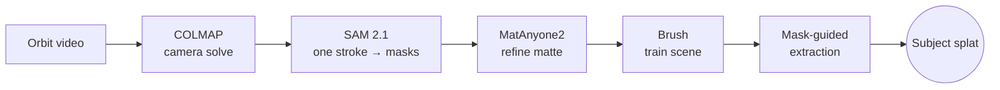

# SplatIm

**From a walk-around phone video to a clean 3D Gaussian splat of one person.**

SplatIm is a local app that turns a phone video, filmed walking around someone, into a 3D Gaussian splat, and then **cuts that person out of the scene**.

<p align="center">
  
</p>

`Python` · `COLMAP` · `SAM 2.1` · `MatAnyone2` · `Brush` · `Gaussian Splatting`

## How it works

The pipeline follows one rule: **every expensive step can be inspected before it runs.** You check the solved cameras, the propagated masks and the mattes before you spend a single minute on training.



1. **Capture an orbit.** Walk around a subject who stays still. COLMAP works out where every frame was taken (up to 120 sampled views).
2. **Select the subject.** Paint one rough brush stroke on a frame and SAM 2.1 tracks the person through every view. You can fix any frame by hand before moving on.
3. **Refine the mattes (optional).** MatAnyone2 makes a cleaner alpha matte. Compare it with the SAM result and keep whichever is better.
4. **Train the scene.** Brush trains one Gaussian scene from the aligned views.
5. **Extract the subject.** The room fades away and only the person is left.

## The hard part: cutting the person out

A trained scene is a cloud of Gaussians with no idea what "person" means. SplatIm projects every Gaussian back into all the masked views and **lets the views vote**:

```python
fraction = fg / np.maximum(fg + bg, 1e-6)
keep = (fg >= 5) & (fraction >= .5)      # enough foreground votes: kept
uncertain = ~(keep | (fg < 2))           # almost none: rejected; the rest: uncertain
```

Uncertain Gaussians get a second chance through a weighted score. One is recovered only if the masks agree, it sits close to trusted geometry and its colour matches its neighbours:

```python
score = (.55 * mask_support      # how much of its footprint lands inside the masks
       + .20 * proximity         # distance to trusted Gaussians
       + .15 * color_support     # colour match with its neighbours
       + .10 * evidence_support) # raw foreground votes
```

Each Gaussian is not judged by its centre pixel alone. Its 3D shape is projected into each camera as a 2D ellipse and sampled at 25 Gauss–Hermite points. See [`outputs/SubjectRecovery.py`](outputs/SubjectRecovery.py) and the [optimization notes](docs/optimization.md).

## Other workflows

| Workflow | Input | Result |
| --- | --- | --- |
| **Video → selected subject** | Orbit video around a still subject | Subject-only splat, with every stage inspectable |
| **Create splat** | One photo, or one frame from a video | Fast single-image splat (Apple SHARP) |
| **Multiple photos → one scene** | Overlapping photos or moving-camera video | One multi-view Gaussian scene |
| **View splat** | `.ply`, `.splat` or `.ksplat` | Interactive local 3D viewer |

## Quick start

> [!NOTE]
> SplatIm is a working prototype set up for a Windows workstation with an NVIDIA GPU. The Python environment, model weights and upstream tools live under `work/` and are not in this repository, so cloning it does not give you a portable install yet.

```powershell
& '.\outputs\Start-SharpSplatUI.ps1'
```

The interface opens at <http://127.0.0.1:7869>. For step-by-step UI and command-line usage, see the [workflow guide](docs/workflows.md).

### Capture tips

- Move the camera around the subject. Turning the subject in front of a fixed camera does not work.
- Move slowly and keep neighbouring views overlapping. Avoid motion blur, sudden cuts and exposure changes.
- Cover the front, sides and back if the splat should look good from every angle.

## Repository layout

```text
SplatIm/
├── outputs/     App source: UI server, pipeline stages, launchers, local viewer
├── tests/       Unit tests and smoke checks
├── docs/        Workflow guide, optimization notes, README media
└── work/        Research scripts (local models, tools and results are git-ignored)
```

Generated splats, masks, frames, videos, arrays and job folders are kept out of Git (see [`.gitignore`](.gitignore)).

## Built on

[Apple SHARP](https://github.com/apple/ml-sharp) · [COLMAP](https://github.com/colmap/colmap) · [SAM 2](https://github.com/facebookresearch/sam2) · [MatAnyone2](https://github.com/pq-yang/MatAnyone2) · [Brush](https://github.com/VAST-AI-Research/Brush)

Each upstream project has its own license and model terms.
